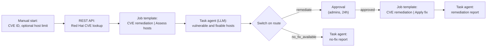

# automation_orchestrator_cve_remediation

Adds a **CVE remediation** workflow to a configured Red Hat Automation Orchestrator (AO). Someone enters a CVE ID, the
workflow finds the vulnerable hosts, a person approves, and the fix is installed from Red Hat Satellite. Modeled on the
OS patch path of the solution guide
[AO-driven CVE routing](https://ansible-tmm.github.io/solution-guides/README-AO-driven-CVE-routing), without Lightwell,
Trusted Profile Analyzer or software bills of materials: CVE data comes from the
[Red Hat CVE database](https://access.redhat.com/security/security-updates/cve) (Red Hat security data API) and host
data from the hosts themselves.

## The workflow

| Step | What it does | Changes hosts |
|---|---|---|
| Enter a CVE | Start form: `cve_id` (pattern `CVE-YYYY-NNNN`), optional `limit` | No |
| Red Hat CVE lookup | `GET <security data URL>/cve/<CVE>.json`; an unknown CVE fails the workflow here | No |
| Assess hosts | Playbook `cve_remediation_assess.yml`: installed packages built from the CVE's source packages, `dnf updateinfo list --cve` (fixes installable from the host's Satellite repositories), fixes already installed, registration server; reported with `set_stats` | No |
| Triage (large language model (LLM)) | Reads the CVE record and the host data and returns typed JSON: `route`, vulnerable and remediable hosts, advisories, packages, reasoning | No |
| Route | `remediate` → approval; `no_fix_available` → report; anything else (`not_affected`) ends the workflow | No |
| Approval | Members of the approver groups/users approve or reject; no decision within the window stops the workflow | No |
| Apply fix | Playbook `cve_remediation_apply.yml` on the remediable hosts only: re-checks applicability, `dnf update-minimal --cve`, reboots only if `dnf needs-restarting -r` asks, re-checks | **Yes** |
| Reports | LLM summaries of the results, or of why no fix is available (content view, registration, unreleased fix, Red Hat mitigation) | No |

Size limits: AO caps a rendered Task agent prompt at 10,000 characters and an approval message at 2,000. The assess job
therefore reports only what matters (fixed releases and product states for the hosts' RHEL major versions, trimmed
mitigation and statement text, installed fixes as advisory IDs). One host uses about 3,000 characters of the triage
prompt and each additional host about 1,200, so check roughly five hosts per run (use the start form's host limit) until
the inventory work aggregates hosts.

Safety: the LLM decides, but the apply playbook re-checks each host and `dnf update-minimal --cve` only installs the
advisory's packages, so a wrong host in the limit is left alone.

## Requirements

- AO with an Ansible Automation Platform (AAP) integration (role `automation_orchestrator_configuration`) and an LLM
  provider integration with an enabled model (role `automation_orchestrator_llm_integration`).
- AAP job templates **CVE remediation | Assess hosts** and **CVE remediation | Apply fix**
  (`configs/cve_remediation/job_templates.yml`), with "prompt on launch" for limit and variables, a machine
  credential with sudo on the hosts, and an inventory of RHEL hosts registered to Satellite.
- AO must reach `access.redhat.com` (public, so no allowlist entry); the job execution environment needs it too.
- Collections: `redhat.openshift` (Red Hat certified; applies objects) and `kubernetes.core` (Red Hat certified; lookups). AO REST calls use `ansible.builtin.uri`.
- Credential (in AAP, attach to the job template that runs this role): *OpenShift API (configuration as code)*.

## How the role works

Discovers AO from the cluster, resolves the project, the AAP integration and its credential, and the LLM model by name,
renders the definition (`vars/main.yml`), checks it with `POST /api/v1/workflows/validate`, then creates the workflow
or saves a new version, and publishes it. The definition's SHA-256 is stored in the workflow labels, so re-runs with the
same inputs change nothing. Request shapes come from the OpenAPI specification AO serves at `/api_docs/v1/openapi.json`;
step output expressions (`${trigger.x}`, `${id.body}`, `${id.artifacts}`, `${id.output}`) follow the AO reference
guide.

## Variables

See `defaults/main.yml`. Inputs normally supplied by the job template survey:

| Variable | Default | Notes |
|---|---|---|
| `automation_orchestrator_cve_remediation_workflow_name` | `CVE remediation` | |
| `automation_orchestrator_cve_remediation_platform_integration_name` | `Ansible Automation Platform` | AO integration that launches AAP jobs |
| `automation_orchestrator_cve_remediation_platform_credential_name` | `""` | Empty = that integration's management credential |
| `automation_orchestrator_cve_remediation_llm_integration_name` | `LLM provider` | |
| `automation_orchestrator_cve_remediation_llm_model` | `""` | Provider model ID; empty = default, else first enabled |
| `automation_orchestrator_cve_remediation_assess_job_template` / `_apply_job_template` | `CVE remediation \| Assess hosts` / `CVE remediation \| Apply fix` | Launched by name in `_organization_name` |
| `automation_orchestrator_cve_remediation_approver_groups` / `_approver_users` | `[admins]` / `[]` | List or comma-separated |
| `automation_orchestrator_cve_remediation_decision_window` | `86400` | Seconds |
| `automation_orchestrator_cve_remediation_reboot` | `true` | Passed to the apply playbook |
| `automation_orchestrator_cve_remediation_validate_certs` | `true` | This job verifies the cluster API and AO certificates |

## Run it

In AO, open **Workflows > CVE remediation**, start it, and enter the CVE ID (and a host limit for testing). Approvers
see the request under **Approvals** with the hosts, advisories and packages. The workflow run history keeps every step's
input and output, including the LLM decisions.
